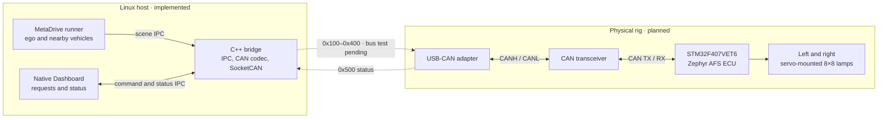
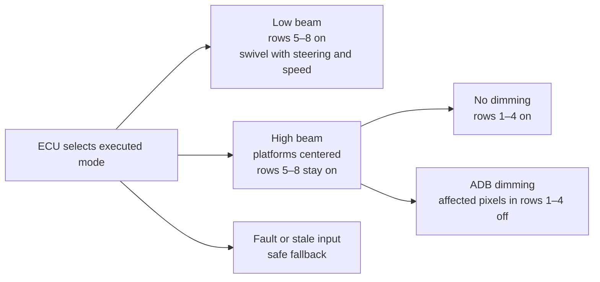
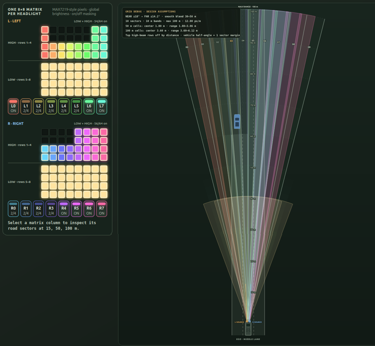
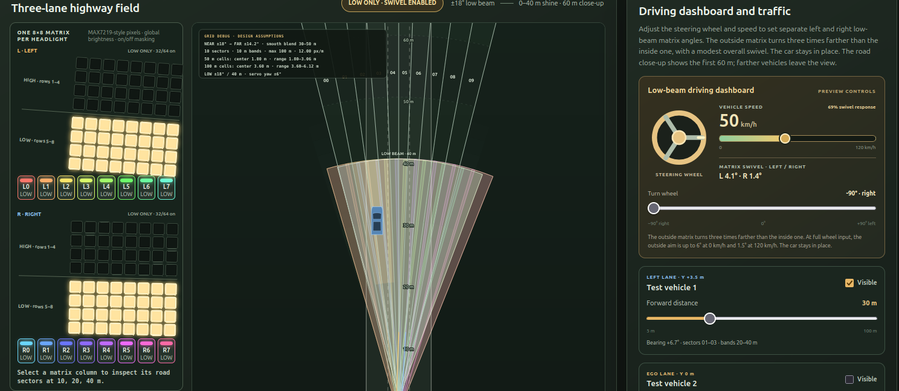
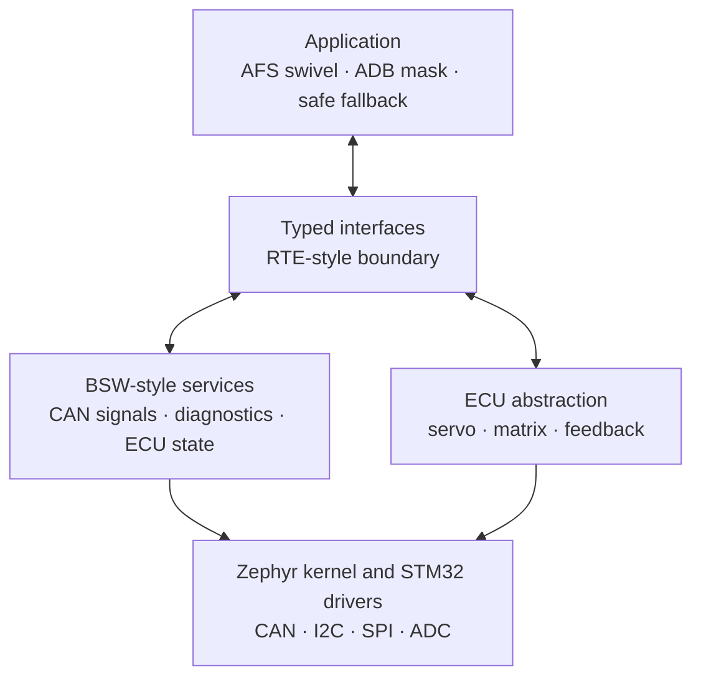

# Adaptive Front-lighting System

A bench prototype that swivels low beams with steering and masks high-beam pixels around vehicles. The ECU target is **STM32F407VET6**.

## System map

| Ready on the Linux host | Next hardware phase |
|---|---|
| Runner → Bridge IPC; Dashboard ↔ Bridge IPC; opt-in SocketCAN TX/RX; Zephyr 3.7 ECU CAN receive/status firmware builds; earlier LED image confirmed; USB-CAN detected as `can0`, configured at 500 kbit/s, bridge IDs `0x100`–`0x400` observed in controller loopback | Diagnose the reported `ENOBUFS` warning; flash and verify ECU CAN against a physical bus; implement servo and matrix control |

The bridge owns host CAN traffic; the ECU will make the final lighting and fallback decisions. [Architecture](docs/architecture/overview.md) · [Data flow](docs/architecture/data-flow.md)

## CAN contract

| ID | Bridge ↔ ECU message | Period |
|---|---|---:|
| `0x100` | Speed → ECU | 20 ms |
| `0x200` | Steering → ECU | 20 ms |
| `0x300` | Ten-sector vehicle grid → ECU | 100 ms |
| `0x400` | Dashboard command → ECU | 50 ms |
| `0x500` | Executed state and faults ← ECU | 50 ms suggested |

The [DBC](bridge/can/afs.dbc) defines the wire format; the [CAN guide](docs/can/README.md) covers validity, timeouts, and checksums. SocketCAN is enabled with `--can-interface NAME`. A virtual CAN integration test is included. Linux detects the adapter as `can0`; 500 kbit/s setup and bridge transmission through controller loopback pass, with IDs `0x100`–`0x400` observed. A reported `ENOBUFS` transmit warning is under investigation; physical bus verification remains pending.

## Light behavior

| [High-beam preview](tools/system_visualization/beam-visual/beam-segments.html) | [Low-beam preview](tools/system_visualization/beam-visual/beam-segments.html?mode=low) |
|---|---|
|  |  |

These are design previews, not live ECU output. The [lamp mapping](docs/architecture/adb-grid-and-lamps.md) records the sector geometry and calibration assumptions.

## Firmware plan

The C application in `firmware/afs_ecu/` uses AUTOSAR-inspired layers. The CAN communication slice builds for Zephyr 3.7 and reports `0x500` at 50 ms while holding `Safe_Default`; incoming `0x100`–`0x400` frames are validated with agreed timeouts and counter rules. The earlier LED image was flashed and confirmed. ECU `printk` diagnostics use RTT over the existing ST-Link SWD connection; the [RTT guide](firmware/docs/rtt_debugging.md) covers setup and startup. Servo/matrix control, CAN transceiver wiring, and physical CAN verification remain. See the [firmware guide](firmware/README.md), [wiring draft](docs/hardware/wiring-draft.md), [ECU design](docs/architecture/components/afs-ecu.md), and [target file layout](docs/temporary/desired_file_system.md).

## Run on Linux

Start each component in its own terminal from the repository root.

| Component | Command |
|---|---|
| Bridge | `bash bridge/scripts/run_runner_bridge.sh` |
| MetaDrive runner | `bash simulation_runner/scripts/start_metadrive_simulation.sh --scene-display` |
| Native Dashboard | `bash dashboard/scripts/start_dashboard.sh` |
| Development visualizations | `bash tools/system_visualization/start_system_visualization.sh` |

The Dashboard opens as a native window. The visualizations are separate browser-based development aids. [Development commands](docs/development.md) · [Verification](docs/verification/testing.md)

## Test changes

Run `bash tools/test_components.sh COMPONENT` after changing `runner`,
`bridge`, `dashboard`, `ecu`, or `visualization`. Run
`bash tools/test_components.sh all` before an integration handoff. The
[testing guide](docs/verification/testing.md) lists the checks and their
hardware limits.

## Project guides

| Component | Guide |
|---|---|
| Simulation | [Runner and scene extraction](simulation_runner/runner.md) |
| Gateway | [Bridge and SocketCAN](bridge/README.md) |
| Dashboard | [Native Dashboard](dashboard/README.md) |
| Firmware and rig | [AFS ECU](docs/architecture/components/afs-ecu.md) · [Wiring draft](docs/hardware/wiring-draft.md) · [Hardware](docs/hardware/hardware.md) |
| Reference | [Documentation index](docs/README.md) · [System Visualization](tools/system_visualization/README.md) · [Hardware wiring view](tools/system_visualization/hardware-wiring/index.html) |
| Contributors | [Agent guide](agents/README.md) |
