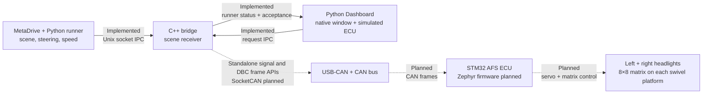
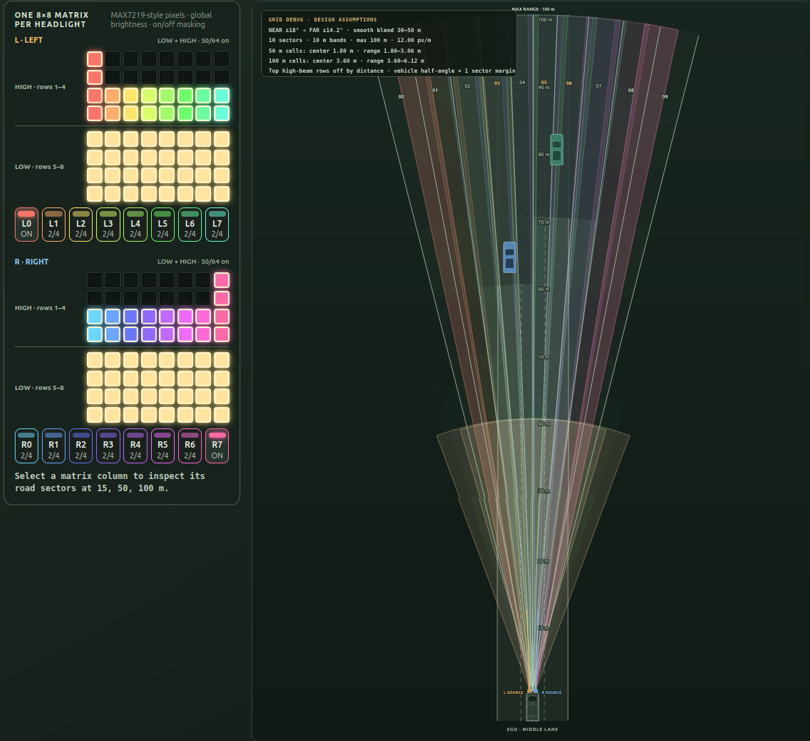
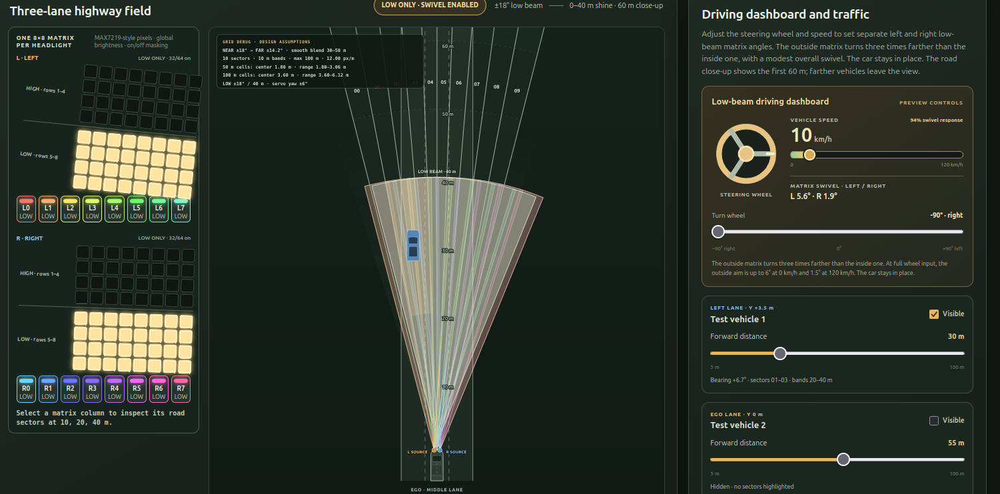

# Adaptive Front-lighting System

A bench-scale design for headlights that **swivel with steering in low beam** and **mask selected pixels around vehicles in high beam**. The proposed rig has one servo-mounted 8×8 MAX7219 LED matrix on each side, controlled by an STM32F407ZG.

**Project status:** MetaDrive scene extraction, runner-to-C++ bridge IPC, Dashboard-to-bridge request/status IPC, and standalone APIs for validating/projecting CAN signals and packing DBC-generated `0x100`–`0x300` frames are implemented. The native Dashboard displays fresh runner ego fields and nearby vehicles when available, sends mode/power requests to the bridge, and labels the proximity grid and ECU values as simulated. A separate diagnostic logger exercises the CAN APIs against live MetaDrive scenes; the production bridge executable does not call them yet. SocketCAN transmission, ECU status reception, Zephyr-based STM32 firmware, and physical lamp control are planned.

## System design



The C++ bridge is the intended sole host owner of project CAN traffic. The STM32 makes the final AFS/ADB lighting decisions and supervises the hardware. ECU status is intended to travel back through the bridge to the Dashboard. See the [architecture overview](docs/architecture/overview.md) and [data flow](docs/architecture/data-flow.md) for the full target design.

## System components and hardware

The proposed bench system combines the simulation and host software with a
physical ECU, CAN wiring, and two servo-mounted matrix headlights. The host
software pieces are implemented or in progress; the hardware and lighting
control remain a build plan.

| Component | Purpose | Status |
|---|---|---|
| MetaDrive + Python runner | Simulate the road, ego car, traffic, steering, and speed; publish scene data | Scene extraction and runner-to-bridge IPC implemented |
| C++ bridge | Receive runner data and Dashboard requests; own host CAN traffic | Runner and Dashboard IPC, CAN signal validation/projection, and DBC-generated frame packing APIs implemented; runtime transport planned |
| CAN-to-USB adapter and CAN bus | Connect the Linux host to the ECU | Proposed hardware; CAN transport planned |
| MCP2551 CAN transceiver | Connect STM32 CAN signals to the physical bus | Proposed hardware |
| STM32F407ZG AFS ECU | Decide beam patterns, supervise feedback, and drive the lamps | Zephyr firmware planned |
| PCA9685 and two feedback servos | Rotate the left and right headlight platforms with steering | Proposed hardware; limits need calibration |
| Two MAX7219 8×8 matrix modules | Provide one shared low/high-beam pixel array per side | Proposed bench display; optical performance needs evaluation |
| Dedicated LED and servo supplies | Power the matrix modules and moving platforms | Select and size for the chosen hardware |

See the [hardware guide](docs/hardware/hardware.md) for wiring, power, and
bring-up constraints.

## Headlight matrix design

The same row layout applies to the **left** and **right** headlights. Each matrix has eight columns, so road sectors are projected to the two lamp positions and mapped to columns; a sector number is not a fixed LED column number.

```text
Each 8×8 matrix, viewed from the front

row 1   H H H H H H H H  ┐
row 2   H H H H H H H H  │ high-beam extension
row 3   H H H H H H H H  │ with adaptive pixel masking
row 4   H H H H H H H H  ┘
row 5   L L L L L L L L  ┐
row 6   L L L L L L L L  │ low-beam base
row 7   L L L L L L L L  │
row 8   L L L L L L L L  ┘
```

| Behavior | Low beam | High beam with low-beam base |
|---|---|---|
| Rows 1–4 | Off | On except masked pixels around relevant vehicles |
| Rows 5–8 | On | Stay on |
| Both matrix platforms | Turn by different angles; the outside matrix turns farther, and speed reduces both | Return to center; no swivel |
| Preview light footprint | Shorter and wider: 40 m, ±18° | Longer and narrower extension: 100 m, ±10° |
| Adaptive masking | Inactive | Only affected high-beam pixels switch off; the rest stay on |

The high-beam preview also shows coarse vertical masking in affected columns:

| Vehicle distance (example) | About 100 m | About 70 m | About 50 m | About 30 m |
|---|---:|---:|---:|---:|
| Upper pixels switched off per affected column | 1 | 2 | 3 | 4 |

Its ten logical road sectors can affect columns in either or both headlights. MAX7219 pixels are individually **on or off**; brightness is **global per matrix**, not individually dimmable per pixel.

The low-beam preview keeps the car still while a steering wheel and speed bar set separate left and right matrix angles. The overall swivel is modest: at full wheel input, the outside matrix turns three times farther than the inside matrix. In a left turn, the right (outside) matrix turns up to 6° while the left (inside) turns 2°; right turns mirror this. At 60 km/h the angles are 3.75°/1.25°, and at 120 km/h they are 1.5°/0.5°. The low-beam road view zooms to 60 m so its 40 m footprint is easy to inspect. These angles, ranges, distance bands, and speed response are visualization assumptions that need optical and mechanical calibration before firmware implementation. See the [ADB grid and lamp mapping](docs/architecture/adb-grid-and-lamps.md) and [headlights design](docs/architecture/components/headlights.md).

## Visual examples

These beam views illustrate the planned behavior. The screenshot spaces are
for preview pictures; they do not show live ECU or hardware output.

### Built system photo

> **Place a photo of the real built system here.**

The [System in Action view](tools/system_visualization/system-in-action/index.html) is a concept illustration for design reference. It is not a photo of the completed hardware.

### [High beam visual](tools/system_visualization/beam-visual/beam-segments.html)

The two matrices stay centered. Rows 5–8 provide the low-beam base; rows 1–4 add high beam and switch off selected pixels around vehicles.

| One car in the high-beam shine zone | Two cars in the high-beam shine zone |
|---|---|
|  |  |

### [Low beam visual](tools/system_visualization/beam-visual/beam-segments.html?mode=low)

Rows 1–4 are off while rows 5–8 swivel with steering. Higher speed reduces the preview swivel response.

| Full right turn at 50 km/h | Full right turn at 10 km/h |
|---|---|
|  |  |

## Current implementation

The Python runner extracts MetaDrive scene data and publishes it to the C++
bridge over a local socket. The bridge receives and retains the latest scene.
Standalone CAN APIs validate steering and speed, project vehicle geometry,
and use the DBC-generated C codec to pack three in-memory frames. A separate
diagnostic logger exercises them against live runner data; they are not wired
into the production bridge executable. The native Dashboard window sends mode
and power requests to the bridge and displays fresh runner ego fields and
nearby vehicles when available. The proximity grid and ECU status remain
simulated. SocketCAN transport,
ECU status reception, Zephyr-based STM32 firmware, and physical lamp control
are planned. The headlight illustrations and beam
screenshots above describe the proposed design; they are not connected to the
runtime or hardware.

## Development tools

The [System Visualization](tools/system_visualization/README.md) pages help
inspect the code, review CAN layouts, and explore the proposed beam behavior. To open them, run from
the repository root:

```bash
bash tools/system_visualization/start_system_visualization.sh
```

Open the printed address (normally
`http://127.0.0.1:8000/tools/system_visualization/`) and use the tabs across
the top. The [Code graph](tools/system_visualization/code-graph/index.html) maps
implemented classes and code paths. The [System in Action page](tools/system_visualization/system-in-action/index.html)
is a static design illustration, not a photo of the built rig. The [High beam
visual](tools/system_visualization/beam-visual/beam-segments.html) and [Low beam visual](tools/system_visualization/beam-visual/beam-segments.html?mode=low)
are interactive previews with no live simulator or hardware connection. The
[CAN messages tab](tools/system_visualization/can-messages/index.html) shows a
byte-by-byte map for each documented frame, with bit cells and arrows linking
to signal names, followed by a table of positions, meanings, and sample values.
It is a static design reference, not live bus traffic. The
**Code updated** timestamp beside the tabs shows the newest modification time
reported by the current page and its local CSS/JavaScript files.

## Run the implemented simulation

On Linux, run from the repository root:

```bash
bash simulation_runner/scripts/start_metadrive_simulation.sh --scene-display
```

The launcher checks requirements before startup. The optional live [scene display](simulation_runner/src/scene_display/README.md) shows extracted ego and surrounding objects; it is separate from the five design/development tabs above. See the [runner guide](simulation_runner/runner.md) for controls and other modes.

Run Python tests with the configured MetaDrive environment when pytest is installed:

```bash
PYTHONPATH=simulation_runner/src \
simulation/metadrive/metadrive_venv/bin/python -m pytest simulation_runner/tests -v
```

If pytest is unavailable, use the [dependency-free test procedure](docs/verification/testing.md).

## Run the native Dashboard

From the repository root, start the native window with:

```bash
bash dashboard/scripts/start_dashboard.sh
```

The window opens without a browser or port. Start the bridge separately with
`bash bridge/scripts/run_runner_bridge.sh` to show fresh runner ego fields and
nearby vehicles and send mode/power requests. Its three sections
show surrounding objects, speed/steering meters with a lighting selection
preview, and driver controls. Mouse-wheel and trackpad scrolling work across
the main window. Mode buttons are disabled while the headlights are off. ECU
display values remain simulated. See the
[Dashboard guide](dashboard/README.md) and [IPC contract](docs/architecture/dashboard-bridge-communication.md).

## Repository guide

| Location | Purpose and current state |
|---|---|
| [`simulation_runner/`](simulation_runner/README.md) | MetaDrive lifecycle, controls, scene extraction, optional live display, and implemented scene publishing |
| [`bridge/`](bridge/README.md) | C++ runner receiver, Dashboard IPC, transport-independent CAN signal validation/projection, DBC-generated frame packing, and a diagnostic MetaDrive frame smoke tool; production transport planned |
| [`dashboard/`](dashboard/README.md) | Native Tkinter window with bridge mode/power requests, fresh runner ego fields and nearby vehicles, and simulated ECU display |
| `firmware/` | Zephyr-based STM32 control and hardware drivers planned |
| [`tools/system_visualization/`](tools/system_visualization/README.md) | Five interactive or static development/design views |
| [`docs/`](docs/README.md) | Architecture, CAN, hardware, tools, and verification guides |
| [`agents/`](agents/README.md) | Repository agent rules, working context, and plans |

The [development guide](docs/development.md) indexes the runnable scripts. The [CAN DBC](bridge/can/afs.dbc) defines the agreed message layouts; generated in-memory frame packing is implemented, while virtual `vcan0` transport and physical `can0` hardware work remain future steps.
