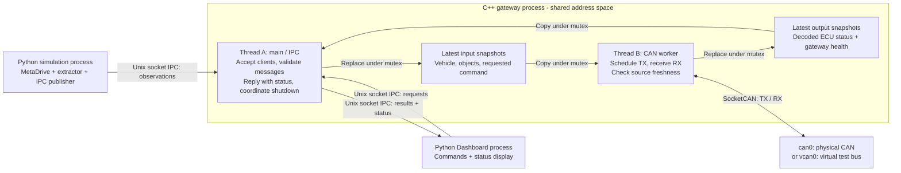

# Data Flow

The target runtime has three Linux application processes. Runner observation and Dashboard command/status IPC use separate local Unix sockets. The native Dashboard consumes fresh runner ego fields and nearby vehicle positions from the bridge and labels the proximity grid and ECU values as simulated. CAN gateway runtime remains planned. Only the C++ gateway will open SocketCAN for production AFS traffic. See [overview.md](overview.md) for the whole-system flowchart.

## Inside The Gateway



The diagram shows the target CAN runtime. Today the bridge handles runner IPC in its main thread and Dashboard IPC in a second thread. There is no CAN worker or decoded ECU status yet. The Python processes never share the C++ state object.

A single event loop could handle the initial traffic; the proposed two-thread split isolates IPC parsing and Dashboard activity from scheduled CAN work. It is not a hard real-time guarantee. Use `poll()` and monotonic deadlines for the CAN worker; a separate RX thread or condition variable is not required by this design.

## Python Simulation Loop

```text
MetaDrive reset/step
  -> take one monotonic timestamp
  -> extract EgoSnapshot and SurroundingSnapshot
  -> construct matching immutable SceneSnapshot
  -> replace the latest in-process scene under a short lock
  -> invoke the preserved ego-only callback
  -> optional scene_display reads the latest scene from its HTTP thread
  -> project and publish through the adapter's IPC client
  -> continue the simulation loop
```

The extraction, scene store, and optional `scene_display` are implemented within the Python process. The runner publisher reads `get_scene_snapshot()` and sends the newest scene over the runner socket in a separate thread. It skips intermediate scenes and does not build a backlog. MetaDrive owns no CAN IDs or payload packing; its lifecycle and driving controls stay in Python.

## Cross-Process Contract

Runner and Dashboard use separate gateway-owned Unix Domain Sockets, `SOCK_SEQPACKET`, with versioned JSON messages. The native Dashboard sends commands and polls status on its socket. The [runner contract](runner-bridge-communication.md) and [Dashboard contract](dashboard-bridge-communication.md) document message fields, freshness, and reconnect behavior.

| Message kind | Producer | Consumer | Meaning |
|---|---|---|---|
| Vehicle state | Python adapter | C++ gateway | Steering, speed, validity, sample identity, and simulation metadata |
| Object state | Python adapter | C++ gateway | Ego-relative observed geometry, dimensions, validity, and sample identity |
| Dashboard command | Python Dashboard | C++ gateway | Requested power/mode or an identified clear-fault action |
| Command result | C++ gateway | Python Dashboard | Gateway accepted or rejected a request |
| System status | C++ gateway | Python Dashboard | Current runner ego fields/nearby vehicles and freshness, retained request ID/state, and ECU unavailable flag; decoded ECU status planned |

Gateway acceptance is not confirmation of physical execution. The Dashboard distinguishes the operator's request, gateway acceptance, and simulated ECU state; ECU-reported execution awaits CAN reception.

Current runner observations use latest-state replacement. Dashboard mode/power commands store the latest request; identified clear-fault actions receive an explicit rejection while the ECU path is absent. The client does not replay pending actions after disconnect.

## CAN Transfer

The existing IDs below remain provisional design values, not new constraints introduced by the refactor.

| CAN ID | Message | Bus producer | Bus consumer |
|---:|---|---|---|
| `0x100` | `Vehicle_Speed` | C++ gateway | AFS ECU |
| `0x200` | `Vehicle_Steering` | C++ gateway | AFS ECU |
| `0x300` | `Vehicle_Object` | C++ gateway | AFS ECU |
| `0x400` | `Dashboard_Command` | C++ gateway | AFS ECU |
| `0x500` | `AFS_Status` | AFS ECU | C++ gateway |

Python converts simulator-specific state into observations. C++ converts observations into the CAN representation, including the 10-sector `0x300` grid with one occupancy bit and a cumulative four-bit subsector mask per sector. One `0x300` frame carries the complete grid; the STM32 performs the final swivel/dimming calculations and physical output selection.

The [CAN DBC](../../bridge/can/afs.dbc) defines CAN packing and signal meaning. Cantools-generated C pack/unpack functions are checked in and used by a standalone C++ frame encoder for `0x100`–`0x300`. A separate diagnostic logger exercises the encoders against live runner scenes, round-trips each batch with generated C unpackers, and cross-checks captured payloads with cantools; the production bridge executable does not yet call the encoder APIs. Runtime transport is planned with native SocketCAN. Counter handling, checksums, and timeouts require explicit application behavior alongside the DBC. The agreed single-frame `0x300` format does not require multi-frame assembly.

## State, Timing, And Failures

- Build and validate complete snapshots before taking the state mutex. Copy or replace under the lock, then release it before encoding, socket I/O, logging, or display.
- Schedule CAN independently from the simulation update interval. Reuse a recent observation only while it satisfies the agreed source-freshness policy.
- Keep source age distinct from CAN alive counters and IPC connection liveness. Receiving or transmitting another copy of an old sample must not make the observation fresh again.
- Track sample/session identity and simulation time separately from host monotonic time. Define restart, reset, pause, backlog, and unpaced-simulation behavior before HIL integration.
- Use bounded buffering; avoid replaying a queue of outdated vehicle states. Define queue-age checks as part of detailed IPC design.
- Missing simulation updates invalidate source data. Dashboard disconnects fail pending actions locally, with no replay. ECU status remains marked simulated until reception exists.
- STM32 independently validates incoming CAN and handles stale/invalid data even if the gateway crashes.
- Waking and joining the CAN worker, closing sockets, and releasing owned resources belong to coordinated gateway shutdown.

Runner and Dashboard IPC are implemented. Standalone CAN validation, projection, and DBC frame packing are implemented; CAN scheduling and transport, decoded ECU status, and firmware behavior remain planned.
