# Data Flow

The runtime has three Linux application processes. Runner observation and Dashboard command/status IPC use separate local Unix sockets. The C++ gateway can open SocketCAN when started with `--can-interface NAME`; it is the only host process that owns production AFS CAN traffic. It sends accepted Dashboard requests in `0x400` and forwards decoded `0x500` ECU status to the Dashboard with age and freshness. See [overview.md](overview.md) for the whole-system flowchart.

## Inside The Gateway

```mermaid
flowchart LR
    SIM["Python simulation process<br/>MetaDrive + extractor + IPC publisher"]
    DASH["Python Dashboard process<br/>Commands + status display"]

    subgraph CPP["C++ gateway process - shared address space"]
        RUNNER_IPC["Thread A: runner IPC<br/>Accept publisher, validate scenes<br/>Replace latest source state"]
        DASHBOARD_IPC["Thread B: Dashboard IPC<br/>Accept commands, serve gateway status"]
        INPUT["Latest input snapshots<br/>Vehicle, objects, requested command"]
        STATUS["Latest accepted ECU status<br/>Forwarded through Dashboard IPC"]
        CAN["Optional Thread C: CAN worker<br/>Schedule TX, receive RX<br/>Check source freshness"]

        RUNNER_IPC -->|"Replace under mutex"| INPUT
        DASHBOARD_IPC -->|"Replace requested command"| INPUT
        INPUT -->|"Copy under mutex"| CAN
        CAN -->|"Replace under mutex"| STATUS
        STATUS -->|"Include freshness in status response"| DASHBOARD_IPC
    end

    SIM -->|"Unix socket IPC: observations"| RUNNER_IPC
    DASH -->|"Unix socket IPC: requests"| DASHBOARD_IPC
DASHBOARD_IPC -->|"Unix socket IPC: acceptance + runner + ECU status"| DASH
    CAN <-->|"SocketCAN: TX / RX"| BUS["can0: physical CAN<br/>or vcan0: virtual test bus"]
```



The bridge handles runner IPC in its main thread and Dashboard IPC in a second thread. When `--can-interface NAME` is provided, a third worker schedules transmit and receive and stores decoded ECU status. The Python processes never share the C++ state object.

The implemented split keeps runner IPC, Dashboard IPC, and CAN scheduling in
separate threads. It is not a hard real-time guarantee. The CAN worker uses
`poll()` and monotonic deadlines; a separate RX thread or condition variable
is not required by this design.

## Python Simulation Loop

```text
MetaDrive reset/step
  -> take one monotonic timestamp
  -> extract EgoSnapshot and SurroundingSnapshot
  -> construct matching immutable SceneSnapshot
  -> replace the latest in-process scene under a short lock
  -> invoke the preserved ego-only callback
  -> optional scene_display reads the latest scene from its HTTP thread
  -> project and publish through the adapter's IPC client
  -> continue the simulation loop
```

The extraction, scene store, and optional `scene_display` are implemented within the Python process. The runner publisher reads `get_scene_snapshot()` and sends the newest scene over the runner socket in a separate thread. It skips intermediate scenes and does not build a backlog. MetaDrive owns no CAN IDs or payload packing; its lifecycle and driving controls stay in Python.

## Cross-Process Contract

Runner and Dashboard use separate gateway-owned Unix Domain Sockets, `SOCK_SEQPACKET`, with versioned JSON messages. The native Dashboard sends commands and polls status on its socket. The [runner contract](runner-bridge-communication.md) and [Dashboard contract](dashboard-bridge-communication.md) document message fields, freshness, and reconnect behavior.

| Message kind | Producer | Consumer | Meaning |
|---|---|---|---|
| Vehicle state | Python adapter | C++ gateway | Steering, speed, validity, sample identity, and simulation metadata |
| Object state | Python adapter | C++ gateway | Ego-relative observed geometry, dimensions, validity, and sample identity |
| Dashboard command | Python Dashboard | C++ gateway | Requested power/mode or an identified clear-fault action |
| Command result | C++ gateway | Python Dashboard | Gateway accepted or rejected a request |
| System status | C++ gateway | Python Dashboard | Current runner ego fields/nearby vehicles and freshness, retained request ID/state and command validity, CAN availability, and decoded ECU status with freshness |

Gateway acceptance is not confirmation of physical execution. The Dashboard distinguishes the operator's request, gateway acceptance, and simulated ECU state; ECU-reported execution awaits CAN reception.

Current runner observations use latest-state replacement. Dashboard mode/power commands store the latest request; `CommandValid` follows the Dashboard connection lease and an accepted request. Clear-fault is rejected when CAN is disabled and otherwise pulses for one successful `0x400` transmission. The client does not replay pending actions after disconnect.

## CAN Transfer

The existing IDs below remain provisional design values, not new constraints introduced by the refactor.

| CAN ID | Message | Bus producer | Bus consumer |
|---:|---|---|---|
| `0x100` | `Vehicle_Speed` | C++ gateway | AFS ECU |
| `0x200` | `Vehicle_Steering` | C++ gateway | AFS ECU |
| `0x300` | `Vehicle_Object` | C++ gateway | AFS ECU |
| `0x400` | `Dashboard_Command` | C++ gateway | AFS ECU |
| `0x500` | `AFS_Status` | AFS ECU | C++ gateway |

Python converts simulator-specific state into observations. C++ converts observations into the CAN representation, including the 10-sector `0x300` grid with one occupancy bit and a cumulative four-bit subsector mask per sector. One `0x300` frame carries the complete grid; the STM32 performs the final swivel/dimming calculations and physical output selection.

The [CAN DBC](../../bridge/can/afs.dbc) defines CAN packing and signal meaning. Cantools-generated C pack/unpack functions are checked in and compiled into the C++ bridge and Zephyr application. When CAN is enabled, the bridge sends `0x100`/`0x200` every 20 ms, the complete `0x300` grid every 100 ms, and Dashboard commands every 50 ms. The ECU validates DLC, reserved fields, validity and mode ranges, and the `0x400` XOR checksum. For `0x100`, `0x200`, and `0x400`, it accepts modulo-16 forward counter deltas of 1–8, rejects duplicates and deltas 9–15, and establishes a new baseline after 500 ms without an accepted frame. The ECU expires speed and steering after 100 ms, the object grid after 250 ms, and a valid dashboard command after 200 ms. It updates the input store and reports the current safe fallback status as `0x500` every 50 ms. The bridge filters for `0x500`, validates it, and forwards accepted status to Dashboard IPC; the Dashboard marks retained status stale after 250 ms without an accepted frame. Since physical control drivers are not implemented, current `0x500` output flags indicate unavailable beam and servo control, and do not verify a physical lamp fallback. A separate diagnostic logger checks encoded payloads against generated C and cantools without bus I/O. The opt-in `socketcan_vcan_end_to_end` test covers `0x400` transmit, one-frame clear-fault pulse, Dashboard disconnect invalidation, and `0x500` forwarding on a prepared virtual CAN interface. The agreed single-frame `0x300` format does not require multi-frame assembly.

## State, Timing, And Failures

- Build and validate complete snapshots before taking the state mutex. Copy or replace under the lock, then release it before encoding, socket I/O, logging, or display.
- Schedule CAN independently from the simulation update interval. Reuse a recent observation only while it satisfies the agreed source-freshness policy.
- Keep source age distinct from CAN alive counters and IPC connection liveness. Receiving or transmitting another copy of an old sample must not make the observation fresh again.
- Track sample/session identity and simulation time separately from host monotonic time. Define restart, reset, pause, backlog, and unpaced-simulation behavior before HIL integration.
- Use bounded buffering; avoid replaying a queue of outdated vehicle states. Define queue-age checks as part of detailed IPC design.
- Missing simulation updates invalidate source data. Dashboard disconnects fail pending actions locally, with no replay. The Dashboard uses simulated ECU fallback values until the bridge receives and forwards a valid CAN status snapshot.
- STM32 independently validates incoming CAN and handles stale/invalid data even if the gateway crashes.
- Waking and joining the CAN worker, closing sockets, and releasing owned resources belong to coordinated gateway shutdown.

Runner and Dashboard IPC, opt-in CAN scheduling/transport, `0x400` command transmission, and `0x500` decoding/forwarding are implemented. Zephyr CAN receive/decode, input timeout checks, and periodic status encoding build for the STM32F407VET6 target; physical ECU flashing and CAN bus validation remain pending. The prior LED app was flashed and its LED operation confirmed. Linux detects the USB-CAN adapter as `can0`; bridge controller-loopback frames are verified, while physical bus exchange remains unverified. Servo/matrix drivers and lighting decisions remain future work. Virtual CAN integration is available through the optional test.
