# System Architecture

Simulated driving and operator requests feed a physical STM32 controller. In low-beam swivel mode, only matrix rows 5–8 shine and both platforms follow steering. In high-beam modes, both platforms return to center, rows 5–8 stay on, and rows 1–4 add the longer beam with optional pixel masking around vehicles. The Dashboard displays the ECU's reported output and faults.

This flowchart shows the target runtime after the component reorganization. The Python runner, controls, ego/surrounding extraction, in-process latest-scene interface, optional development display, runner-to-bridge IPC, and native Dashboard IPC are implemented. The bridge has an opt-in SocketCAN worker that transmits `0x100`–`0x400`, decodes `0x500`, and forwards ECU status to Dashboard IPC. Virtual CAN integration coverage is available; physical adapter/ECU verification and Zephyr-based STM32 firmware remain future work.

Use the [interactive code map](../../tools/system_visualization/code-graph/index.html) to
explore implemented classes and their interactions. Nodes are clustered by
layer; clicking one highlights its direct connections and expands smaller
member circles. The right panel describes the selected node and links to source.
Its Functionalities section highlights ordered, implemented paths such as ego
extraction, surrounding extraction, and browser display on the same graph.
For a visitor-facing picture of the intended complete physical setup, use the
[System in Action walkthrough](../../tools/system_visualization/system-in-action/index.html).
It is a static 3D render of the laptop, CAN wiring, STM32, and two 8x8 matrix
headlights with low-beam and high-beam rows.

## System At A Glance

```mermaid
flowchart LR
    subgraph HOST["Same Ubuntu / Linux system - three application processes"]
        subgraph SIM["Process 1: Python simulation + adapter"]
            MD["MetaDrive<br/>Road, ego vehicle, surrounding traffic"]
            STORE["Latest SceneSnapshot<br/>Lock-protected replacement"]
            SD["scene_display<br/>Optional development HTTP thread"]
            AD["Simulation adapter<br/>Automatic Unix socket publisher"]
            MD -->|"Extract after reset / step"| STORE
            STORE -->|"Read latest scene"| SD
            STORE -->|"Read latest scene"| AD
        end

        subgraph GATEWAY["Process 2: C++17 gateway"]
            GW["Vehicle / CAN gateway<br/>Runner receiver; standalone validate, project, and pack APIs"]
        end

        subgraph DASHBOARD["Process 3: Python Dashboard"]
            UI["Operator HMI<br/>Power / mode requests<br/>Executed state + faults"]
        end

        AD -->|"Unix socket IPC<br/>Vehicle + object state"| GW
        UI -->|"Unix socket IPC<br/>Headlight requests"| GW
        GW -->|"Unix socket IPC<br/>ECU status + gateway health"| UI
    end

    BUS["CAN adapter<br/>Physical CAN bus"]
    ECU["STM32 AFS ECU - Zephyr RTOS (C)<br/>Low-beam swivel + high-beam pixel masking<br/>Timeouts, faults, safe fallback"]
    RIG["Physical headlight rig<br/>Swivel servos + two 8x8 matrix modules"]

    GW <-->|"SocketCAN / can0<br/>Input frames and ECU status"| BUS
    BUS <-->|"CAN frames via ECU transceiver"| ECU
    ECU -->|"Servo + SPI matrix patterns"| RIG
    RIG -->|"Servo position feedback"| ECU

    classDef python fill:#e8f1ff,stroke:#265d97,color:#142b45
    classDef native fill:#e7f5ed,stroke:#28704a,color:#173e2a
    classDef hardware fill:#fff2dc,stroke:#97621a,color:#4f3510
    class MD,STORE,SD,AD,UI python
    class GW native
    class BUS,ECU,RIG hardware
```

The forward path is MetaDrive -> Python adapter -> IPC -> C++ gateway -> CAN -> STM32 -> headlights. Operator requests join at the gateway. ECU status returns through CAN and the gateway to the Dashboard; servo feedback goes directly to STM32.

## Processes And Threads

A process is a separately running program with its own memory. Threads are execution paths inside one process and can share that process's memory. These applications are three processes, not three threads.

| Application process | Application work | Communication |
|---|---|---|
| Python simulation + adapter | Run MetaDrive, extract and retain the latest scene, automatically publish it to the gateway, optionally serve the development display | Lock-protected local scene access; local HTTP for the optional observer; Unix socket IPC to the gateway |
| C++ gateway | Runner receiver, Dashboard command/status server, opt-in SocketCAN worker (`0x100`/`0x200` every 20 ms; `0x300` every 100 ms; `0x400` every 50 ms), and `0x500` status decoder | Mutex-protected latest scene/status; separate runner and Dashboard Unix sockets; SocketCAN opens only with `--can-interface NAME` |
| Python Dashboard | Native window for command entry, fresh runner ego fields/nearby vehicles, and live ECU status with simulated fallback | Reconnecting Unix socket client to gateway; local demo state supplies fallback values until a valid ECU status arrives |

The process numbers identify applications, not startup order or dedicated CPU cores. MetaDrive and UI libraries may use additional internal threads. The Dashboard window and its Unix socket client belong to the same Python process. A future combined launcher can start the simulation and Dashboard windows together.

See [data-flow.md](data-flow.md) for the gateway thread diagram and the distinction between socket IPC and in-process state.
The [ADB grid and two-headlamp mapping](adb-grid-and-lamps.md) describes the
proposed logical sector and physical lamp data types.

## Ownership

| Component | Owns |
|---|---|
| [MetaDrive and Python adapter](components/metadrive.md) | Simulation lifecycle, driving controls, extraction, simulator coordinate conversion, and observation publishing |
| [C++ gateway](components/bridge.md) | IPC, current source state, CAN conversion/scheduling/TX/RX, decoded ECU status, and communication diagnostics |
| [Dashboard](components/dashboard.md) | Operator requests and display of reported state |
| [STM32 ECU](components/afs-ecu.md) | Final AFS/ADB decisions, actuator commands, feedback supervision, and independent fault/timeout handling |
| [Headlight rig](components/headlights.md) | Physical low-beam swivel and matrix low/high beam output |

## Current Implementation And Design Status

- The Python implementation is under `simulation_runner/`. Its runner constructs a matching ego and ground-truth surrounding `SceneSnapshot` after every reset and step, atomically replaces a process-local latest value, preserves the existing ego-only callback, and can serve the read-only `scene_display` development observer.
- `bridge/` contains the C++17/CMake runner and Dashboard socket servers, standalone CAN validation/projection, DBC-generated frame packing, optional SocketCAN scheduling and transport, and ECU status decoding/forwarding.
- `dashboard/` contains a native Tkinter window and reconnecting gateway client. Mode/power requests reach the bridge; fresh runner ego fields, nearby vehicle positions, and accepted ECU status replace demo values where available. The proximity grid remains simulated and labeled.
- The runner publisher and C++ receiver implement versioned local socket IPC and latest source-state retention. The bridge also serves Dashboard request/status IPC, sends `0x400`, and forwards decoded `0x500` status. Zephyr-based STM32 firmware and physical HIL are not implemented.
- The runner observation boundary uses C++17/CMake and Unix Domain Sockets with `SOCK_SEQPACKET` carrying versioned JSON. The [runner–bridge communication contract](runner-bridge-communication.md) documents the implemented fields, limits, and recovery policy.
- The established component layout and future deeper structure are documented in [desired_file_system.md](../temporary/desired_file_system.md).

## Virtual Tests And Physical HIL

Use `vcan0` for gateway integration tests with CAN inspection tools or a software ECU. It is a virtual bus and has no physical STM32 connection. A full SIL control test also needs software ECU logic; virtual CAN alone does not exercise AFS control.

The flowchart above shows physical HIL through `can0`, a CAN adapter, the bus, and the ECU transceiver. The STM32F407VE owns the CAN controller; transceiver selection, logic levels, termination, and wiring remain hardware bring-up work.
