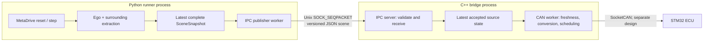

# Runner–Bridge Communication

**Status: initial implementation.** The runner publisher and bridge receiver
implement protocol v1 and the candidate defaults in this document. These are
bench defaults; they do not establish calibrated ECU safety thresholds.
Runner IPC carries the active MetaDrive `max_steering_deg`; the bridge requires
a positive finite limit when present and rejects a steering angle outside its
range. When the limit is `null`, the raw steering sample is retained, but a CAN
encoder must mark it invalid.

## Purpose And Boundary

The runner publishes observations. The bridge validates and retains the newest
observation, then independently converts it to scheduled CAN input. The STM32
decides the lighting output. The runner never packs CAN frames or selects LED
zones, and the bridge never reads MetaDrive objects or Python process memory.



The publisher reads the complete scene with `get_scene_snapshot()`. It must not
combine separate ego and surrounding getter calls, because those calls can see
different samples. The existing `scene_display` remains an independent local
observer. See [data-flow.md](data-flow.md) for the other gateway clients and
threads.

## Transport

| Item | Implementation |
|---|---|
| Connection | Local Linux `AF_UNIX` socket with `SOCK_SEQPACKET`; one JSON document per packet. |
| Ownership | Bridge binds and listens; runner connects as a client. One active runner publisher is accepted at a time; another receives `hello_reject`. The Dashboard uses a separate connection and contract. |
| Socket location | A configurable absolute path. Default: `$XDG_RUNTIME_DIR/afs/runner-bridge.sock`, or `/tmp/afs-<uid>/runner-bridge.sock` when `XDG_RUNTIME_DIR` is unset. The bridge creates and secures the private socket directory and removes stale socket paths. |
| Access | Directory mode `0700`, socket mode `0600`, and same-UID peer verification. Both programs still validate every packet. |
| Framing | One UTF-8 JSON object in one packet. No newline delimiter or partial-message assembly. Reject truncated or oversized packets. |
| Size | Maximum packet size: **64 KiB**. The sender checks its encoded size; the receiver checks size and truncation before parsing. |
| Direction | Runner sends `hello` and `scene`; bridge replies to `hello` with `hello_ack` or `hello_reject`. No per-scene acknowledgment in this version. |

The socket path and limits are configuration, not embedded in the scene schema.
The first IPC release is local to one host; it does not expose TCP or remote
clients. The runner starts its publisher on every invocation and reconnects
until the bridge receiver is available.

## Protocol V1

The envelope has `protocol_version` and `type`. Both sides reject an unknown
major version or message type. The bridge sends `hello_ack` only after checking
the version and the runner role. The runner sends no scenes before that reply.
Protocol versioning here is independent of the scene display's HTTP JSON
`schema_version` and of the CAN DBC.

```json
{"protocol_version":1,"type":"hello","role":"runner","runner_session":"8f134b6e-5eca-4ebd-8fa1-786be0d8b183"}
```

An accepted handshake replies with one packet:

```json
{"protocol_version":1,"type":"hello_ack","runner_session":"8f134b6e-5eca-4ebd-8fa1-786be0d8b183"}
```

The runner creates a random `runner_session` for each invocation. A socket
reconnection within that invocation keeps the same session and continues its
sequence number. A new invocation creates a new session and begins at sequence
one. `hello_ack` echoes the accepted version and session; `hello_reject` gives
a bounded reason code, then the bridge closes the connection.

Each `scene` packet is a **full replacement**, including an empty object list
when a valid scan finds no objects. It is never a delta and never a command to
the ECU. The proposed compact shape is:

```json
{
  "protocol_version": 1,
  "type": "scene",
  "runner_session": "8f134b6e-5eca-4ebd-8fa1-786be0d8b183",
  "sequence": 42,
  "captured_monotonic_ns": 123456789000000,
  "sample": {"source": "metadrive", "seed": 21, "episode_step": 41, "sim_time_s": 2.46},
  "quality": {"ego_valid": true, "objects_valid": true, "objects_degraded": false, "objects_truncated": false},
  "ego": {"steering_deg": 3.2, "max_steering_deg": 60.0,
          "longitudinal_speed_mps": 12.5},
  "objects": [
    {"id": "vehicle-7", "type": "VEHICLE", "x_forward_m": 28.0,
     "y_left_m": 3.1, "length_m": 4.5, "width_m": 1.8,
     "relative_heading_rad": 0.04}
  ]
}
```

| Field | Meaning and rule |
|---|---|
| `runner_session`, `sequence` | Identify publication across episode resets. Sequence is a strictly increasing unsigned integer within one runner invocation; gaps are allowed, and it is not `episode_step`. |
| `captured_monotonic_ns` | Host `CLOCK_MONOTONIC` time of the source scene, converted from the shared extraction timestamp. It is never the socket send time. Both processes run on the same Linux host. |
| `sample` | Diagnostic source and simulation metadata. `seed`, `episode_step`, and `sim_time_s` may be `null` when unavailable; they do not determine wall-clock freshness. |
| `quality` | Independent ego and object extraction validity. `objects_degraded` records an incomplete scan; the agreed CAN policy invalidates the grid for any degraded scan. `objects_truncated` means the IPC object cap dropped candidates. |
| `ego.steering_deg` | Ego steering angle in degrees using MetaDrive's extracted sign and scale. The bridge preserves the sign without inversion or normalization. `null` means unavailable; the bridge does not invent a valid steering value. `0x200 SteeringValid` is also cleared when the source scene is older than 250 ms. |
| `ego.max_steering_deg` | Active MetaDrive vehicle steering limit in degrees, captured with this ego sample. It must be a positive finite value when present. `null` means unavailable; a CAN encoder must mark the `0x200` steering input invalid. When both fields are present, the bridge validates `steering_deg` against `±max_steering_deg`. |
| `ego.longitudinal_speed_mps` | Signed speed along ego heading, positive forward and negative reverse. `null` means direction cannot be established. The agreed `0x100` design carries this signed value with `0.01 m/s/bit` scaling in a signed 16-bit field and does not use a separate reverse bit. `SpeedValid` is cleared when the source scene is older than 250 ms. |
| `objects` | Complete list of selected registry objects in this sample. `x_forward_m` and `y_left_m` are ego-relative metres; positive left matches the proposed object-grid convention. Dimensions are metres; `relative_heading_rad` is relative to ego heading. Optional geometry fields may be `null`. |

The Python adapter projects these fields from `SceneSnapshot`; it does not
serialize `raw_state`, `step_info`, world coordinates, camera frames, exception
strings, or the scene display's JSON payload. The registry extractor currently
supports vehicles, pedestrians, cyclists, and traffic objects. The IPC list
keeps their semantic `type`; the bridge decides which types are relevant to
the provisional vehicle-only ADB grid. IDs are for diagnostics and do not
become CAN signals.

All numeric values must be finite where present. Required keys must be present;
nullable values use JSON `null`, not `NaN`, infinity, or omitted keys. The
bridge validates types, ranges, object count, string lengths, and packet size
before replacing state. Proposed limits are **128 objects**, **64 bytes per
object ID**, and a bounded type string. If more than 128 objects qualify, the
adapter keeps the closest 128 and sets both `objects_truncated` and
`objects_degraded`; a valid empty list remains distinct from an invalid scan.
The bridge does not treat missing or malformed objects as "no vehicles."
Truncation may omit a vehicle relevant to glare avoidance. The agreed bridge
policy is to set `GridValid=0`, `PerceptionDegraded=1`, and
`ObjectListOverflow=1`, then clear all `0x300` sector records when
`objects_truncated=true`. Any other object-scan degradation or unusable vehicle
geometry also sets `PerceptionDegraded=1`. Transfer, parse, and freshness
faults alone set `GridValid=0` and clear the records but do not set the
perception-specific flag. The ECU ignores the grid and applies fallback
lighting. This encoding and fault-notification policy is not implemented yet.

`ego_valid=false` or `objects_valid=false` can be sent deliberately with
`null`/empty data and valid sample metadata. The bridge marks that input
unusable immediately. If only the object side fails, a usable steering/speed
sample may still be retained; an invalid object scan must not clear the grid as
if it were a valid empty scan. Missing required numeric fields invalidate the
corresponding CAN input even when the higher-level extraction flag is true.

## Timing, Freshness, And Backpressure

The runner publishes after reset and after each step. A separate publisher
worker reads the latest complete scene, so socket waits do not stall MetaDrive.
It sends each observed scene at most once, caps publication at **20 Hz**, and
skips intermediate scenes when a headless simulation runs faster.
There is no application-level observation queue. Socket backpressure means the
worker drops its pending old scene and reconnects to send the current scene.

The bridge records receipt time but calculates **source age** from
`captured_monotonic_ns`, not from the last packet or CAN transmission. The
maximum source age for runner-derived `0x100`, `0x200`, and `0x300` inputs is
**250 ms**. An older sample sets `SteeringValid=0`, `SpeedValid=0`, and
`GridValid=0`; the bridge also clears all `0x300` sector records. A packet
already older than that at receipt is rejected as stale and invalidates those
CAN inputs. Future-dated timestamps beyond a small clock tolerance and
duplicate or out-of-order sequence numbers within a session are also rejected
and invalidate the runner-derived CAN inputs. Sequence gaps are allowed
because the publisher intentionally skips intermediate scenes; a gap alone
does not trigger fallback. An accepted duplicate of old content must never
refresh source age.

The bridge drains readable scene packets and applies the newest well-formed
scene with a sequence greater than the last accepted one, including an explicit
invalid-quality scene. The target CAN behavior retains the last accepted scene
for diagnostics, but a detected malformed, oversized, stale, or otherwise
rejected scene immediately invalidates the runner-derived CAN inputs:
subsequent `0x100` and `0x200` frames set `SpeedValid=0` and `SteeringValid=0`,
and `0x300` frames carry `GridValid=0` and zero sector records. The ECU clears
its active grid and enters fallback. A fresh accepted scene is required to
restore validity. Expected sequence gaps are allowed and do not trigger
fallback.
The CAN worker samples source state on its own schedule; a 20 ms CAN period can
reuse one 60 ms simulation sample only while that sample is fresh. Simulation
pause, lost updates, socket disconnect, and bridge restart cannot make old data
fresh. CAN alive counters are separate from source sequence numbers.

This fail-closed CAN policy still needs implementation in the IPC/CAN state
path. Today, `RunnerIpcServer` logs malformed or oversized packets and skips
stale packets while retaining the previous `scene_` and `has_scene_` state;
the CAN worker therefore needs an explicit invalid-source state or fault
signal so a rejected packet cannot leave retained steering, speed, or grid
data marked valid.

## Connection And Failure Behavior

| Event | Proposed behavior |
|---|---|
| Bridge starts first | Listen with no valid simulation source until a runner connects. |
| Runner starts first or bridge restarts | Simulation remains usable without IPC. Publisher retries connection with bounded backoff, sends `hello`, then sends only the latest still-fresh scene. No history replay. |
| Runner restarts | New session ID and sequence reset. Bridge discards old source state before accepting the new session. |
| Episode resets | Same runner session; sequence continues while `seed`, `episode_step`, and `sim_time_s` may reset. |
| Socket closes | Target: keep transmitting `0x300` with `GridValid=0` and zero sector records until a fresh accepted scene. The ECU clears the active grid and enters fallback. The current receiver marks the source unavailable on disconnect; CAN transmission is not implemented yet. |
| Malformed or incompatible packet | Target: count and log a bounded diagnostic, reject the packet, and invalidate the `0x300` grid until a fresh accepted scene. Incompatible `hello` closes the connection. Repeated malformed packets may close it. The current receiver logs and rejects malformed scene packets but does not yet invalidate its retained scene state. |
| Two publishers | Reject the second active runner connection; never merge samples from different sessions. |
| Slow bridge | Runner worker remains nonblocking, drops intermediate scenes, and cannot create an unbounded replay queue. |

Gateway receipt is not proof of ECU execution. The bridge's later CAN design
must ensure stale or invalid source data is never retransmitted as a valid new
observation; the STM32 independently checks CAN validity and timeouts.
Diagnostics should distinguish connection state, last accepted sequence,
source age, malformed packets, stale packets, sequence drops, and publisher
skips. The Dashboard status contract will be designed separately.

## Implementation Scope And Limits

The implementation uses the listed limits as initial bench defaults. Steering
is passed through from MetaDrive's extracted steering angle with its sign
preserved; the publisher includes `ego.max_steering_deg`, and the receiver
validates steering against that active limit rather than a fixed angle range.
When the limit is unavailable, it remains `null` for the future CAN encoder to
mark steering invalid. Longitudinal speed is the ego velocity projected onto
the extracted heading. Truncated object lists are marked degraded and
truncated. The fail-closed `0x300` policy is an agreed design rule but is not
implemented yet. The receiver validates and retains source state only; it does
not perform CAN conversion or actuation.
