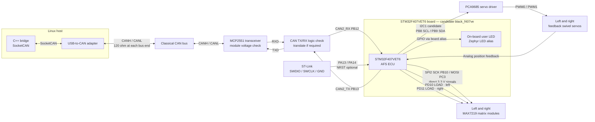
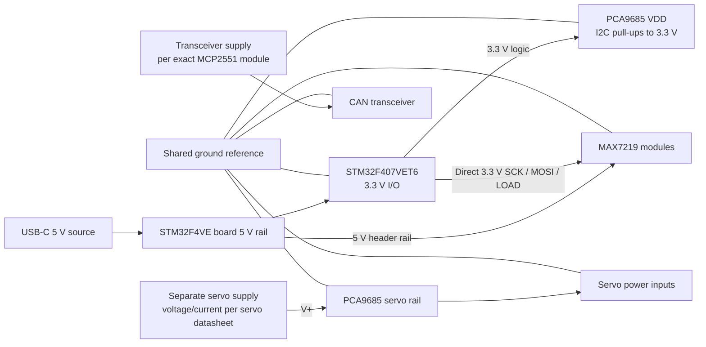

# AFS ECU Wiring Draft

**Revision:** Draft 0.1 — for review, not a build-ready schematic.

This draft is for the STM32F407VET6 on the board marked `STM32F4VE ver 36C
SN:2024C`. Zephyr's `black_f407ve` target is a useful candidate, but the exact
board revision and header routing still need to be checked against the board's
schematic. Zephyr marks the target as not actively maintained. Its board page
documents an 8 MHz crystal, a default 168 MHz clock, CAN2 on PB12/PB13, and
SPI2 on PB10/PC2/PC3. [Zephyr board documentation](https://docs.zephyrproject.org/latest/boards/others/black_f407ve/doc/index.html)

The [hardware wiring view](../../tools/system_visualization/hardware-wiring/index.html)
shows these candidate routes in a Proteus-style schematic with selectable nets.
It is a visual companion to this draft, not a confirmed schematic.

For the first firmware milestone, connect only the ST-Link and use the board's
on-board user LED through Zephyr's board LED alias. Leave the CAN transceiver,
servos, and matrix modules disconnected until their supplies and logic levels
are checked.

## Signal Wiring

The diagram shows functional signal paths. The exact header positions and the
external module pin labels must be checked before wiring. The candidate pin
choices below are not yet an approved pinout.

## Candidate Pin Assignments

| Function | Candidate MCU assignment | Connect to | State |
|---|---|---|---|
| First blink | Board-defined `led0` alias | On-board user LED | Use Zephyr's board alias; confirm it maps to the intended LED on this board revision. |
| Debug/programming | PA13 SWDIO, PA14 SWCLK, GND, and board 3.3 V as VTref; NRST optional | ST-Link SWD header | The project OpenOCD config declares no physical NRST wire and uses Cortex-M software reset. Verify header orientation. VTref is a voltage reference, not a supply. |
| CAN | CAN2_TX PB13, CAN2_RX PB12 | MCP2551 TXD/RXD | Matches the Zephyr board's default CAN2 mapping. Use CAN2 only; the board notes currently do not support enabling CAN1 and CAN2 simultaneously. |
| PCA9685 I2C | I2C1 SCL PB8, SDA PB9 | PCA9685 SCL/SDA | Candidate alternate-function route; verify these pins are exposed and free on the `ver 36C` board. Keep I2C pull-ups at 3.3 V. |
| Matrix SPI | One SPI2 bus: SCK PB10, MOSI PC3; MISO PC2 unused | Both MAX7219 CLK and DIN | Matches the Zephyr board's default SPI2 mapping. SCK and MOSI are shared by both modules. |
| Matrix LOAD | PD10 and PD11 as GPIO outputs | Left and right MAX7219 LOAD (sometimes labeled CS) | Candidate pins only; verify header availability and board conflicts. Each module has an independent LOAD line. |
| Servo feedback | PA1 / ADC123_IN1 for left; PA4 / ADC12_IN4 for right | Servo analog feedback outputs | Candidate ADC pins. Verify the servo's feedback pinout and ensure its maximum voltage stays within the STM32 ADC input range. |
| Optional console | USART1 TX PA9, RX PA10 | 3.3 V USB-UART adapter | The board documentation says its ST-Link virtual COM port is not wired to the MCU UART. Not needed for the first LED blink. |

The CAN2/SPI2 defaults and LED/debug information come from Zephyr's board
documentation. The I2C and ADC assignments are candidates based on the STM32F407
alternate-function table; board-header access still needs verification in the
board schematic. [STM32F407 datasheet](https://www.st.com/resource/en/datasheet/stm32f407ve.pdf)

## Power And Ground

- Keep servo motor power on its separate supply. This draft powers the matrix
  modules from the board's USB-C-fed 5 V header rail; verify that the USB-C
  source and board/header path can carry the combined load. Use a separate
  regulated 5 V source if they cannot.
- PCA9685 logic supply and I2C pull-ups should be at 3.3 V. Its separate servo
  power rail comes from the external servo supply. Check the breakout board for
  pull-ups tied to a different rail. The PCA9685 IC accepts a 2.3–5.5 V logic
  supply. [NXP PCA9685 datasheet](https://www.nxp.com/docs/en/data-sheet/PCA9685.pdf)
- The matrix modules get 5 V power from the board rail. The selected prototype
  wiring connects the STM32's 3.3 V SCK, MOSI, and separate LOAD GPIO signals
  directly to the bare MAX7219 inputs. This is a bench-test choice, not a
  datasheet-guaranteed logic level: at a 5 V supply the MAX7219 specifies a
  3.5 V minimum logic-high input, above the STM32's 3.3 V GPIO level. Verify
  reliable operation during bring-up; add a compatible one-way buffer for
  these four signals if direct drive is unreliable. The buffer would change
  signal levels only; matrix VCC remains on the board's 5 V rail.
  [MAX7219/MAX7221 datasheet](https://www.analog.com/media/en/technical-documentation/data-sheets/MAX7219-MAX7221.pdf)
- Both MAX7219 modules share SPI2 clock and data. The MAX7219 shifts DIN on
  every rising CLK edge; only the module whose LOAD line rises latches the last
  16 bits. Give each matrix its own direct GPIO LOAD line so their patterns can
  be updated independently. Some breakouts label this pin `CS`.
- MCP2551 modules may use 5 V logic. Verify both directions, especially the
  transceiver RXD voltage reaching the STM32, before connecting it. Add
  level-shifting or choose a 3.3 V-compatible interface if required.
- Join logic, transceiver, servo, and matrix grounds at a shared reference.
  Check whether the USB-CAN adapter is galvanically isolated before connecting
  its ground pin to the bench reference.
- The Zephyr `black_f407ve` board notes that its USB 5 V and external 5 V pins
  are directly connected without protection. Do not power it from USB and an
  external 5 V source at the same time unless the exact board revision's power
  circuit confirms that is safe.

## CAN Bus Termination

Use a linear CANH/CANL bus with one 120 ohm termination at each physical end.
The ECU transceiver and Linux USB-CAN adapter attach as nodes; do not add a
third terminator if one is already built into an adapter or board. Connect a
reference ground only when the adapter's isolation design allows it. The bus
bit rate is 500 kbit/s per the project DBC.

## Items To Confirm Before Schematic Sign-Off

1. Verify the complete board identity and header layout for `STM32F4VE ver
   36C SN:2024C` against the `black_f407ve` board definition.
2. Confirm the proposed I2C1, chip-select, and ADC pins are exposed and do not
   conflict with board peripherals.
3. Record the exact MCP2551 module, PCA9685 breakout, MAX7219 modules, servo
   models, and their connector pinouts.
4. Check module logic voltages, servo feedback output range, supply currents,
   connector polarity, and adapter/board termination switches.
5. Approve the board match, pin map, and power plan before initializing the
   Zephyr project or connecting powered actuators and matrix modules.

Until those checks are complete, treat the diagram and pin table as a review
draft. The first LED-blink test does not depend on the external wiring.
